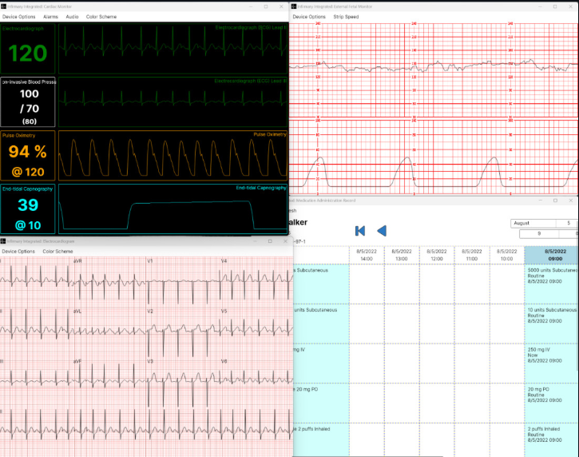
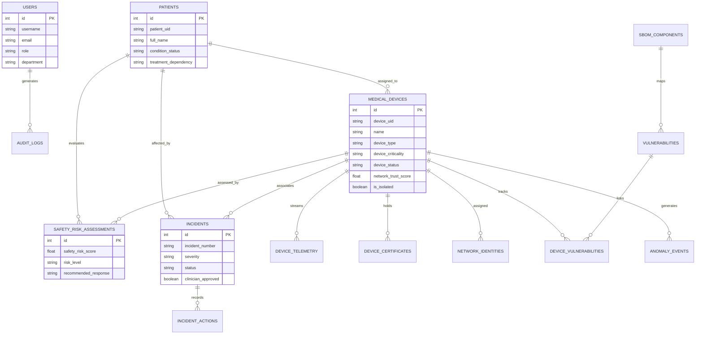

# <p align="center"></p>

<p align="center">
  <strong>Cybersecurity Framework &amp; Patient Safety Risk Engine for Connected Medical Devices</strong><br/>
  <em>A functional Cyber-Physical System (CPS) for clinical telemetry protection and treatment continuity</em>
</p>

<p align="center">
  <a href="https://jagan96404.github.io/MedSentinel-/"></a>
  <a href="https://github.com/Jagan96404/MedSentinel-/actions"></a>
  
  
  
</p>

---

## 🌟 Live Interactive Platform
- 🌐 **Live Web Application**: [https://jagan96404.github.io/MedSentinel-/](https://jagan96404.github.io/MedSentinel-/)
- 💻 **Source Code Repository**: [https://github.com/Jagan96404/MedSentinel-](https://github.com/Jagan96404/MedSentinel-)
- 📑 **Comprehensive Project Academic Report**: [`docs/PROJECT_DOCUMENTATION.md`](docs/PROJECT_DOCUMENTATION.md)

---

## 📌 Executive Summary & Problem Statement

Hospitals deploy thousands of connected medical devices (Internet of Medical Things – IoMT), including mechanical ventilators, smart infusion pumps, multi-parameter cardiac monitors, closed-loop insulin delivery systems, and patient wearables. These devices communicate telemetry continuously over Wi-Fi, Bluetooth LE, and hospital micro-VLANs. 

### The Life-Threatening Problem:
Traditional IT cybersecurity systems operate on a **disconnect immediately** principle: when an endpoint behaves suspiciously, firewall rules sever network connectivity or isolate device power. 
> ⚠️ **In a clinical hospital environment, blindly severing network or power from an active mechanical ventilator or inotropic infusion pump can be fatal to the patient.**

### The MedSentinel Solution:
**MedSentinel CPS** resolves this fundamental conflict by making cybersecurity decisions informed by **both**:
1. **Cybersecurity threat severity and vulnerability metrics**
2. **Real-time patient physiological condition and treatment continuity requirements**

```
Connected medical device / simulator
               ↓
    Secure hospital gateway (Micro-VLAN & Zero-Trust)
               ↓
    MedSentinel monitoring platform
               ↓
    Anomaly Detection (Isolation Forest + Deterministic Rules)
               ↓
    CORE INNOVATION: Patient Safety Risk Engine
               ↓
    Safe action (VLAN microsegmentation without power disruption)
               + Clinician dual-key authorization + Immutable audit log
```

---

## 🖥️ Clinical Monitor & Output System View

MedSentinel provides an authentic, high-resolution **4-Quadrant Clinical Monitor Output System View** matching real-world hospital bedside workstations:

<p align="center">
  
</p>

### The 4 Synchronized Clinical Quadrants:
1. **Top-Left — Infirmary Integrated: Cardiac Monitor**:
   - High-fidelity **60 FPS HTML5 Canvas real-time animated waveforms**.
   - **ECG Lead II** (Green trace with physiological QRS deflection, P-wave, T-wave, and digital readout: `120 bpm`).
   - **Non-Invasive Blood Pressure (NIBP)** (White readout: `100 / 70 (80)` mmHg with arterial waveform).
   - **Pulse Oximetry Plethysmograph** (Amber photoplethysmograph wave with `% SpO2 @ bpm`: `94 % @ 120`).
   - **End-Tidal Capnography (EtCO2)** (Cyan alveolar plateau waveform: `39 @ 10` mmHg / RR).
   - Menu controls: Device Options, Alarm audio toggles, Lead selectors, and cyber jitter indicators.

2. **Top-Right — Infirmary Integrated: External Fetal Monitor**:
   - Classic medical red millimeter grid paper strip.
   - Dual-channel continuous tracing: **Fetal Heart Rate (FHR 60–240 bpm)** and **Tocodynamometer (Uterine Contraction Pressure 0–100 mmHg)** with variable strip speed controls (1, 2, 3 cm/min).

3. **Bottom-Left — Electrocardiogram (12-Lead Diagnostic ECG)**:
   - Full 12-lead diagnostic format (**I, II, III, aVR, aVL, aVF, V1, V2, V3, V4, V5, V6**) rendered on clinical pink millimeter graph paper at calibrated 25 mm/s and 10 mm/mV.

4. **Bottom-Right — Medication Administration Record (MAR)**:
   - Hourly administration schedule (09:00 to 14:00 block) tracking intravenous infusions (e.g., Norepinephrine titrations via pump `INF-204`), subcutaneous injections, and oral meds.
   - Live Infusion Guard intercepts and blocks unauthorized dosage modifications.

---

## 💡 Core Innovation: The Patient Safety Risk Engine

Traditional security models assess risk as $\text{Impact} \times \text{Likelihood}$. MedSentinel introduces a multidimensional Cyber-Physical formula that incorporates treatment dependency:

$$\text{Safety Risk Score} = (\text{Device Criticality} \times \text{Cyber Threat Severity} \times \text{Patient Condition}) + \text{Vulnerability Severity} + \text{Network Trust Risk} - \text{Treatment Continuity Protection}$$

### Factor Quantifications:

| Factor | Parameter | Weight / Scaling | Clinical Rationale |
|---|---|---|---|
| **Device Criticality ($W_{dc}$)** | Life-Critical / High / Moderate / Low | **3.0x** / **2.2x** / **1.5x** / **1.0x** | Ventilators & defibrillators carry highest patient impact |
| **Cyber Threat Severity ($W_{ts}$)** | Critical / High / Medium / Low / None | **4.5x** / **3.2x** / **2.0x** / **1.0x** / **0.5x** | Evaluates active socket exploitation, brute force, MitM |
| **Patient Condition ($W_{pc}$)** | Critical / Warning / Stable | **3.5x** / **2.0x** / **1.0x** | ARDS or septic patients cannot tolerate signal dropout |
| **Vulnerability Severity** | Max detected CVE CVSS v3 score | **$0 \to 20$ points** | Scaled linearly from CVSS 0.0 to 10.0 |
| **Network Trust Risk** | Inverse zero-trust telemetry score | **$0 \to 20$ points** | Derived from $(100 - \text{Trust}) \times 0.20$ |
| **Treatment Continuity ($P_{tc}$)** | Protective safety deduction | **$-10.0$ points** | **Prevents fatal automated device shutdown** |

### Score Ranges & Prescribed Responses:
- **0–29 (Low Risk)**: Device secure and operating normally. Baseline monitoring.
- **30–59 (Moderate Risk)**: Flag for security review; verify X.509 certificate and mutual TLS handshake.
- **60–79 (High Risk)**: Enhanced packet logging; inspect process execution; schedule non-disruptive patching.
- **80–100 (Critical Risk)**: 
  > 🚨 **Crucial Safety Rule**: **DO NOT POWER OFF OR SEVER DEVICE.**  
  > 1. Restrict network traffic to approved local ICU telemetry micro-VLAN.  
  > 2. Dispatch high-priority alert to attending clinician and biomedical SOC.  
  > 3. Enforce **Dual-Key Clinician Authorization** before any intrusive firmware or network mitigations.

---

## 🏗️ 6-Layer Cyber-Physical Architecture

```mermaid
graph TD
    subgraph L1 ["1. PHYSICAL LAYER (Connected Medical Devices)"]
        VENT["Dräger Evita Ventilator (VENT-016)<br/>Life-Critical"]
        INF["Alaris Infusion Pump (INF-204)<br/>Life-Critical"]
        ECG["Philips IntelliVue Monitor (CARD-042)<br/>High Criticality"]
        FETAL["Corometrics Fetal Monitor (FETAL-008)<br/>High Criticality"]
        GLU["MiniMed Insulin Pump (GLU-071)<br/>High Criticality"]
        WEAR["BioButton Wearable (WEAR-115)<br/>Moderate Criticality"]
        DEFIB["ZOLL Defibrillator (DEFIB-003)<br/>Life-Critical"]
    end

    subgraph L2 ["2. CLINICAL DATA LAYER"]
        VITALS["Physiological Synthesizer: HR, SpO2, NIBP, EtCO2, RR, Temp, Waves"]
        PAT["15 Clinical Patient Profiles (ARDS, Sepsis, Post-Op, Trauma)"]
    end

    subgraph L3 ["3. COMMUNICATION LAYER"]
        GW["Hospital Gateway & Micro-VLAN Routing (VLAN 104 / 108)"]
        PKI["X.509 PKI & Mutual TLS Mutual-Authentication (Hospital Root CA)"]
        ZT["Zero-Trust Network Trust Scoring (0-100%)"]
    end

    subgraph L4 ["4. CYBERSECURITY LAYER"]
        SBOM["Software Bill of Materials (20 Embedded Components)"]
        CVE["Vulnerability Engine (15 Realistic CVEs with CVSS v3)"]
        RBAC["Role-Based Access Control (Admin, Analyst, Clinician)"]
    end

    subgraph L5 ["5. INTELLIGENCE LAYER"]
        ISO["Scikit-Learn Isolation Forest Anomaly Detector"]
        RULES["Deterministic Threat Heuristic Correlator"]
        ENGINE["Core Patient Safety Risk Engine Formula"]
    end

    subgraph L6 ["6. RESPONSE & CONTROL LAYER"]
        SAFE_ACL["Safe VLAN Microsegmentation (Power Preserved)"]
        DUAL_KEY["Dual-Key Clinician Authorization Workflow"]
        AUDIT["Immutable Audit Trail & Compliance Log"]
    end

    L1 --> L2
    L2 --> L3
    L3 --> L4
    L4 --> L5
    L5 --> L6
```



---

## 🔄 End-to-End Workflow & Life-Support Safety Example

```
                      SCENARIO 3: ACTIVE ICU VENTILATOR ATTACK
                      
Step 1: Physical Telemetry Stream
   Dräger Ventilator VENT-016 (ICU Room 08) generates live telemetry:
   Heart Rate: 120 bpm | SpO2: 94% | Respiratory Rate: 28/min
   Active Patient: Arthur Pendelton (Severe ARDS - Mechanical Ventilation Dependent)

Step 2: Cyber Anomaly Detection
   Device initiates unauthorized outbound TCP connection to external host 198.51.100.74:4444.
   Network traffic surges to 312 kbps; packet jitter exceeds threshold.
   Isolation Forest anomaly score: 0.94 (Threat Severity: Critical).

Step 3: Patient Safety Risk Engine Evaluation
   Device Criticality : Life-Critical (3.0x)
   Threat Severity    : Critical (4.5x)
   Patient Condition  : Critical (3.5x)
   Vulnerability CVSS : 8.8 (FreeRTOS Buffer Overflow)
   Network Trust      : 34.0%
   Treatment Protection : -10.0 pts (Life-Support Continuity Lock)
   → FINAL SAFETY RISK SCORE: 91 / 100 (CRITICAL)

Step 4: Prescribed Safe Response
   ❌ Automated power-off or complete network disconnect is PROHIBITED.
   ✅ Action: Restrict external egress; isolate communication to local ICU telemetry VLAN.
   ✅ Dispatch immediate alerts to ICU Clinician and Biomedical SOC Analyst.
   ✅ Require Clinician Dual-Key Authorization before scheduling firmware patch maintenance.
```

---

## 💻 Tech Stack & Engineering Specifications

| Tier | Technologies | Highlights |
|---|---|---|
| **Frontend UI** | **React 18, TypeScript, Vite** | Single-Page Application (SPA) with relative asset routing |
| **Styling & Icons** | **Tailwind CSS, Lucide React** | Medical command center dark palette (`#0B1120`, navy, cyan, emerald, amber, red) |
| **Data Visualization** | **HTML5 Canvas (60 FPS), Recharts** | High-performance medical waveform rendering and fleet trend analysis |
| **Backend API** | **Python 3.11+, FastAPI, Uvicorn** | Asynchronous RESTful architecture with OpenAPI/Swagger interactive docs |
| **ORM & Database** | **SQLAlchemy 2.0, SQLite / PostgreSQL** | Zero-friction SQLite out-of-the-box; production PostgreSQL via Docker |
| **Machine Learning** | **Scikit-Learn (Isolation Forest), NumPy** | Multi-dimensional telemetry vector anomaly detection |
| **Authentication** | **PyJWT (JSON Web Tokens), PBKDF2-SHA256** | Role-based access control with granular permissions |
| **Real-Time Engine** | **WebSockets (`/ws/telemetry`)** | 60 FPS synchronized medical telemetry broadcast bus |
| **Deployment** | **GitHub Pages, Docker Compose, Render, Vercel** | Multi-target continuous deployment with automated GitHub Actions CI/CD |

---

## 🗄️ Database Architecture (Entity-Relationship)



---

## 📱 Navigation & Platform Modules

1. **Command Center (`/`)**: Executive dashboard with KPI metrics, fleet safety risk gauges, 6-hour risk trend graphs, device status distribution, priority incident lists, and the Patient Safety Watch panel.
2. **Clinical Output View (`/clinical-view`)**: The **4-quadrant multi-monitor display** from the reference image with live animated waveforms, alarms, and attack toggles.
3. **Hospital Digital Twin (`/digital-twin`)**: 2.5D spatial floor plan across ICU, Cardiology, NICU, Operating Room, and General Ward with color-coded device nodes.
4. **Medical Device Inventory (`/devices`)**: Searchable, filterable catalog of all 25 connected medical devices with quick safe isolation and restoration controls.
5. **Device Detail Page (`/devices/:id`)**: Comprehensive 7-tab view (Overview, Live Telemetry, Security Events, SBOM, Vulnerabilities, Safety Assessments, and Audit History).
6. **Patient Safety Center (`/patient-safety`)**: Patient condition monitoring, treatment dependency tracking, and clinician acknowledgement workflows.
7. **Threat Detection Center (`/threats`)**: Anomaly feed with explainable root causes, confidence scores, and an **interactive real-time risk engine calculator sandbox**.
8. **Incident Response Kanban (`/incidents`)**: Triage board (Open, Investigating, Contained, Resolved, False Positive) with **Dual-Key Clinician Authorization modals**.
9. **SBOM Management (`/sbom`)**: Inventory of 20 embedded software components and 15 simulated CVEs prioritized by patient safety impact.
10. **Scenario Simulator (`/simulator`)**: One-click testbed to inject 8 real-world cyber-physical scenarios into the live system.

---

## ⚡ Quick Start & Execution

### 1. Run Live in Browser (No Installation Needed)
Access the live deployed application on GitHub Pages:  
👉 **[https://jagan96404.github.io/MedSentinel-/](https://jagan96404.github.io/MedSentinel-/)**

### 2. Local Run on Windows (One-Click)
Double-click [`run_dev.bat`](run_dev.bat) or execute in PowerShell:
```powershell
.\run_dev.ps1
```

### 3. Manual Step-by-Step Run
#### Backend (Terminal 1):
```bash
cd backend
python -m pip install -r requirements.txt
python seed.py
python -m uvicorn app.main:app --host 0.0.0.0 --port 8000 --reload
```
- Swagger API Docs: `http://127.0.0.1:8000/docs`
- WebSocket Telemetry: `ws://127.0.0.1:8000/ws/telemetry`

#### Frontend (Terminal 2):
```bash
cd frontend
npm install
npm run dev
```
- Frontend UI: `http://localhost:5173`

### 4. Docker Compose Multi-Container Run
```bash
docker-compose up --build
```
- Frontend: `http://localhost:5173`
- Backend API: `http://localhost:8000/docs`
- PostgreSQL: `localhost:5432`

---

## 🔐 Demo User Roles

Use the **Active Role** dropdown in the top navigation bar or log in with:

| Role | Email | Password | Access Level |
|---|---|---|---|
| **Administrator (CISO)** | `admin@medsentinel.hospital` | `Admin@123` | Full administrative control, policies, and fleet management |
| **Security Analyst (SOC)** | `analyst@medsentinel.hospital` | `Analyst@123` | Threat triage, incident management, and safe network isolation |
| **Clinician (ICU Attending)** | `clinician@medsentinel.hospital` | `Clinician@123` | Patient safety alerts, dual-key sign-off, and treatment verification |

---

## 🧪 Testing & Validation

Run the backend Pytest test suite:
```bash
cd backend
python -m pytest tests/ -v
```
**Test Cases Covered:**
- `test_patient_safety_risk_engine_normal`: Validates low-risk score (< 30) for baseline devices.
- `test_patient_safety_risk_engine_ventilator_critical_threat`: Verifies that life-support ventilators on critical patients trigger high safety scores (> 80) and **strictly prohibit automated shutdown**.
- `test_anomaly_detector_untrusted_endpoint`: Asserts that unauthorized external socket connections trigger immediate Isolation Forest detection.

---

## 📄 License & Compliance Notice

This project is developed for educational, academic, and research demonstration purposes. All patient names, device identifiers, and telemetry data are safely simulated. The framework adheres to FDA Pre-market Guidance for Medical Device Cybersecurity and Zero-Trust IoMT architectural principles.
