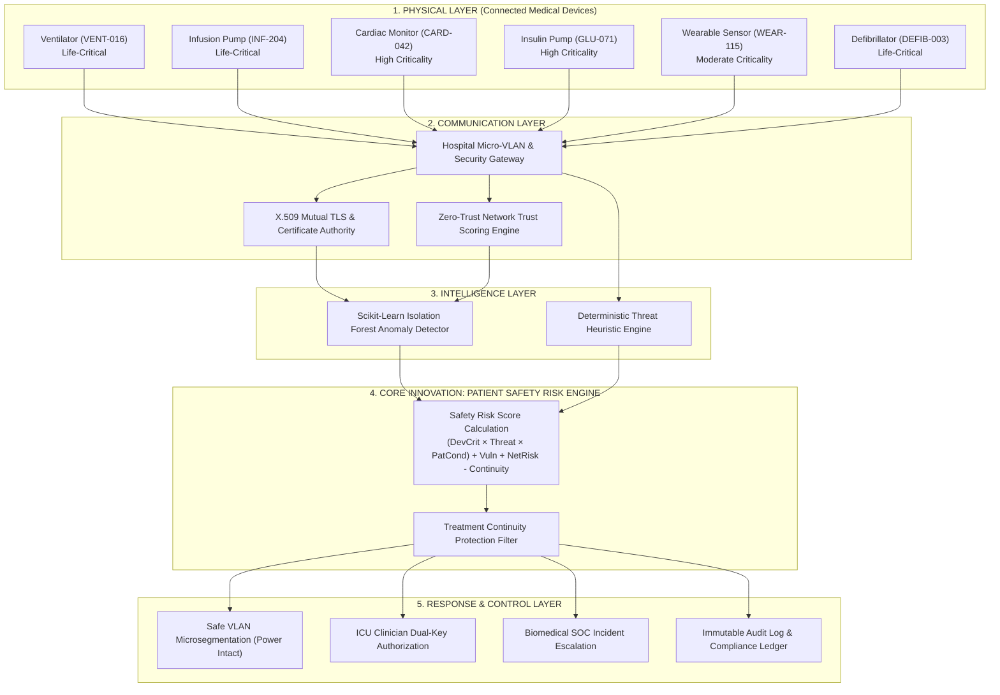
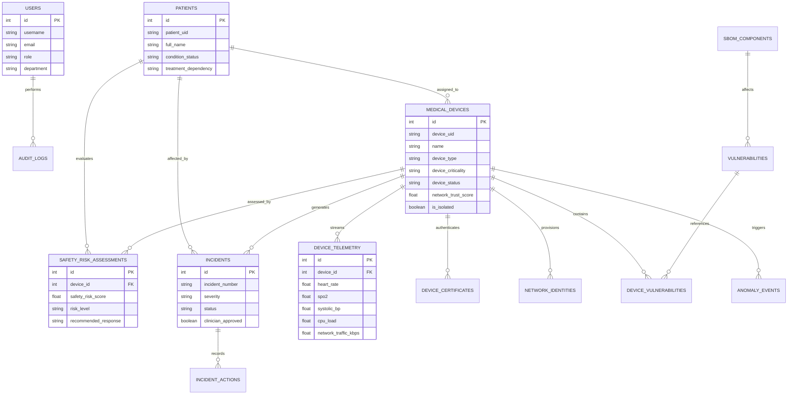

# MedSentinel CPS: Cybersecurity Framework for Connected Medical Devices
## Comprehensive Technical Documentation, Academic Report & Defense Guide

---

## 1. Project Abstract
Connected medical devices (Internet of Medical Things – IoMT)—such as mechanical ventilators, infusion pumps, cardiac telemetry monitors, closed-loop insulin delivery systems, and external defibrillators—are increasingly networked across hospital micro-VLANs, Wi-Fi, Bluetooth LE, and cloud endpoints. While connectivity dramatically accelerates clinical diagnosis and patient response times, it renders clinical physical devices susceptible to firmware exploitation, brute-force authentication attacks, unauthorized external command injection, and denial of service. Traditional IT cybersecurity mechanisms typically enforce immediate network disconnect or power isolation upon threat detection; however, blindly severing network or power connectivity from an active mechanical ventilator or inotropic infusion pump directly endangers human life.

**MedSentinel CPS** resolves this fundamental conflict by introducing a Cyber-Physical System (CPS) framework centered on an explainable **Patient Safety Risk Engine**. MedSentinel correlates real-time device telemetry, cryptographic identity health, and network behavioral vectors with the patient's acute physiological condition and treatment dependency. Rather than executing disruptive automated shutdowns, the framework enforces safe microsegmentation, VLAN ACL restrictions, enhanced high-frequency monitoring, and clinician dual-key approval.

---

## 2. Problem Statement
Connected hospital infrastructure faces three primary vulnerabilities:
1. **Device Vulnerability Profile**: Medical devices operate on embedded RTOS firmware (e.g., FreeRTOS, lwIP, OpenSSL) with extended lifecycles, often carrying known unpatched CVEs due to stringent medical certification re-validation cycles.
2. **Context-Blind Security Controls**: Conventional Intrusion Detection Systems (IDS) lack clinical awareness; automated containment actions risk precipitating fatal patient therapy interruptions.
3. **Telemetry Tampering & Exfiltration**: Threat actors can manipulate physiological telemetry streams (spoofing arrhythmias or masking respiratory failure), prompting incorrect clinical drug interventions.

---

## 3. Project Objectives
1. **Physical & Clinical Emulation**: Build realistic multi-parameter telemetry simulators for 6 critical medical device classes and 15 distinct clinical patient profiles.
2. **Zero-Trust Communication Layer**: Implement continuous X.509 certificate expiry verification, mutual TLS authentication, and network trust scoring (0–100).
3. **Hybrid Intelligence Layer**: Couple scikit-learn Isolation Forest unsupervised anomaly detection with rule-based deterministic clinical safety guards.
4. **Patient Safety Risk Engine**: Formulate and compute a weighted Cyber-Physical risk score balancing device criticality, cyber threat severity, patient physiological condition, vulnerability impact, network trust, and treatment continuity protection.
5. **Human-in-the-Loop Clinical Governance**: Establish dual-key authorization workflows requiring attending clinician confirmation before non-emergency remedial network actions are applied to active life-support devices.
6. **Clinical Output System Reproduction**: Deliver an authentic, synchronized 4-quadrant bedside monitoring system view featuring a live 60 FPS Cardiac Monitor, External Fetal & Tocodynamometer Strip, 12-Lead Diagnostic ECG Strip, and Medication Administration Record (MAR).

---

## 4. CPS Architecture (Mermaid Diagram)

---

## 5. Database Entity-Relationship (ER) Diagram (Mermaid)

---

## 6. Core Innovation: Patient Safety Risk Engine

### Mathematical Formula:
$$\text{Safety Risk Score} = (\text{Device Criticality} \times \text{Cyber Threat Severity} \times \text{Patient Condition Severity}) + \text{Vulnerability Severity} + \text{Network Trust Risk} - \text{Treatment Continuity Protection}$$

### Factor Quantifications:
1. **Device Criticality ($W_{dc}$)**: Low (1.0), Moderate (1.5), High (2.2), Life-Critical (3.0).
2. **Cyber Threat Severity ($W_{ts}$)**: None (0.5), Low (1.0), Medium (2.0), High (3.2), Critical (4.5).
3. **Patient Physiological Condition ($W_{pc}$)**: Stable (1.0), Warning (2.0), Critical (3.5).
4. **Vulnerability Severity**: Scaled linearly from maximum detected CVSS v3 score ($0 \to 20$ points).
5. **Network Trust Risk**: Derived from inverse network trust score: $(100 - \text{Trust}) \times 0.20$ ($0 \to 20$ points).
6. **Treatment Continuity Protection ($P_{tc}$)**: Deducts $10.0$ points when a Life-Critical device is actively treating a Critical patient, preventing disruptive automatic shutdown while escalating containment to local ICU VLANs.

---

## 7. 12-Slide Project Presentation Outline

- **Slide 1**: Title: *MedSentinel CPS: Cybersecurity Framework for Connected Medical Devices*. Subtitle, Author, Institution, Advisor.
- **Slide 2**: The Clinical Problem: The proliferation of IoMT devices and the fatal risks of traditional IT disconnect mechanisms on active life support.
- **Slide 3**: The Real-World Workflow: Gateway ingestion $\to$ Zero-Trust $\to$ Anomaly Engine $\to$ Patient Safety Risk Engine $\to$ Protected Clinical Action.
- **Slide 4**: CPS 6-Layer Architecture: Physical, Clinical, Communication, Cybersecurity, Intelligence, and Control Layers.
- **Slide 5**: Core Innovation: The Patient Safety Risk Engine mathematical formulation and treatment continuity exception.
- **Slide 6**: Machine Learning Telemetry Detection: Scikit-learn Isolation Forest on multi-dimensional telemetry vectors.
- **Slide 7**: Interactive Hospital Digital Twin: Spatial 2.5D mapping of hospital floors and device status nodes.
- **Slide 8**: Clinical Monitor & Output System View: Bedside 4-quadrant display (Cardiac Monitor, Fetal Monitor, 12-Lead ECG, MAR).
- **Slide 9**: Zero-Trust, SBOM & Vulnerability Priority: Tracking firmware components and scoring patch priority based on patient impact.
- **Slide 10**: Incident Response & Dual-Key Authorization: Kanban workflow and attending physician sign-off.
- **Slide 11**: Real-World Demo Scenarios: Walkthrough of Scenarios 1 through 4 (Ventilator network threat containment).
- **Slide 12**: Conclusion & Future Scope: Hardware-in-the-loop validation, HL7/FHIR EHR integration, and post-quantum cryptographic migration.

---

## 8. Viva Voce Questions and Comprehensive Answers

**Q1: Why can't a hospital simply use standard enterprise Endpoint Detection & Response (EDR) software on medical devices?**  
*Answer*: Standard enterprise EDR tools are designed for general computing systems (laptops, servers). They lack awareness of patient physiological states and frequently enforce automated quarantine actions—such as killing processes or severing network sockets—which on a mechanical ventilator or infusion pump would abruptly terminate life-sustaining ventilation or vasoactive drug delivery. Furthermore, medical devices run specialized real-time operating systems (RTOS) with minimal compute margins that cannot support heavy EDR agents.

**Q2: How does MedSentinel ensure treatment continuity during a high-severity network attack?**  
*Answer*: The Patient Safety Risk Engine recognizes when a device is flagged as "Life-Critical" and associated with a "Critical" patient. Instead of powering down the device or severing all interfaces, MedSentinel applies microsegmentation rules at the network switch/gateway level. It restricts egress to external networks while maintaining local ICU VLAN communication, allowing the clinician to monitor vitals and the pump/ventilator to continue operating safely.

**Q3: How does the Isolation Forest model detect anomalies in medical device telemetry?**  
*Answer*: The Isolation Forest algorithm isolates observations by randomly selecting a feature and a split value. Outliers require fewer splits to be isolated compared to nominal operating vectors. MedSentinel feeds feature vectors combining CPU load, network traffic (kbps), packet rates, and failed mutual-authentication handshakes into the model. When a compromised device begins port scanning or mining crypto, its path length shortens dramatically, producing a high anomaly score.

**Q4: What is the significance of the 4-quadrant Clinical Monitor System View?**  
*Answer*: Medical cyber-physical systems must be validated within authentic clinical user contexts. The 4-quadrant view reproduces the standard hospital monitoring infrastructure: multi-parameter cardiac waveforms (ECG, NIBP, SpO2, EtCO2), external fetal/tocodynamometer strips, 12-lead diagnostic electrocardiograms, and the Medication Administration Record (MAR). This allows clinical staff to inspect patient vitals in real time while monitoring zero-trust security indicators.

**Q5: What is Dual-Key Authorization in medical incident response?**  
*Answer*: Dual-Key Authorization requires both a cybersecurity professional (Security Analyst) and a healthcare professional (Attending Clinician) to sign off before invasive remedial actions (such as firmware updates, device rebooting, or physical device swaps) can proceed on life-critical devices during active patient treatment.

